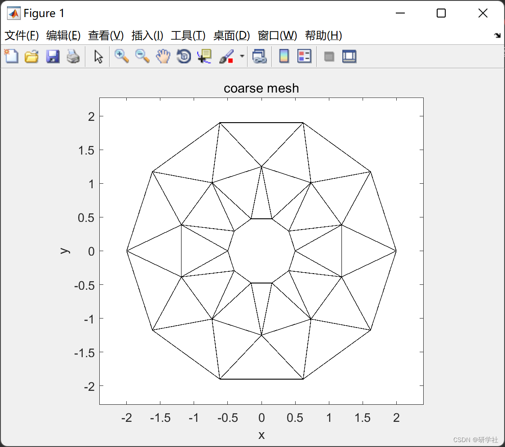
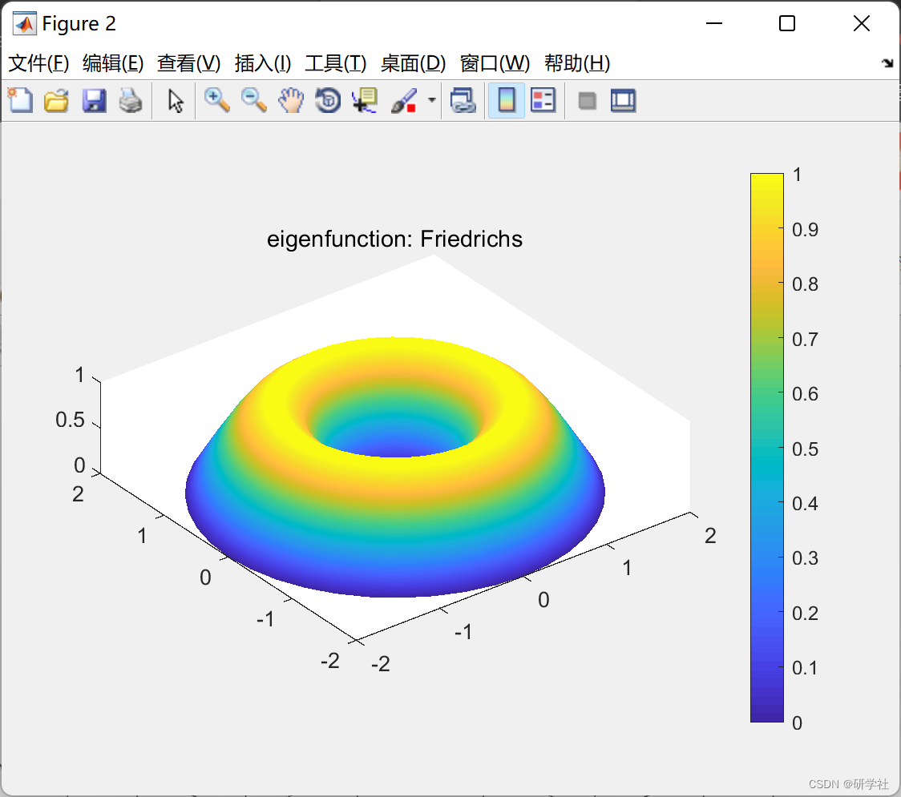
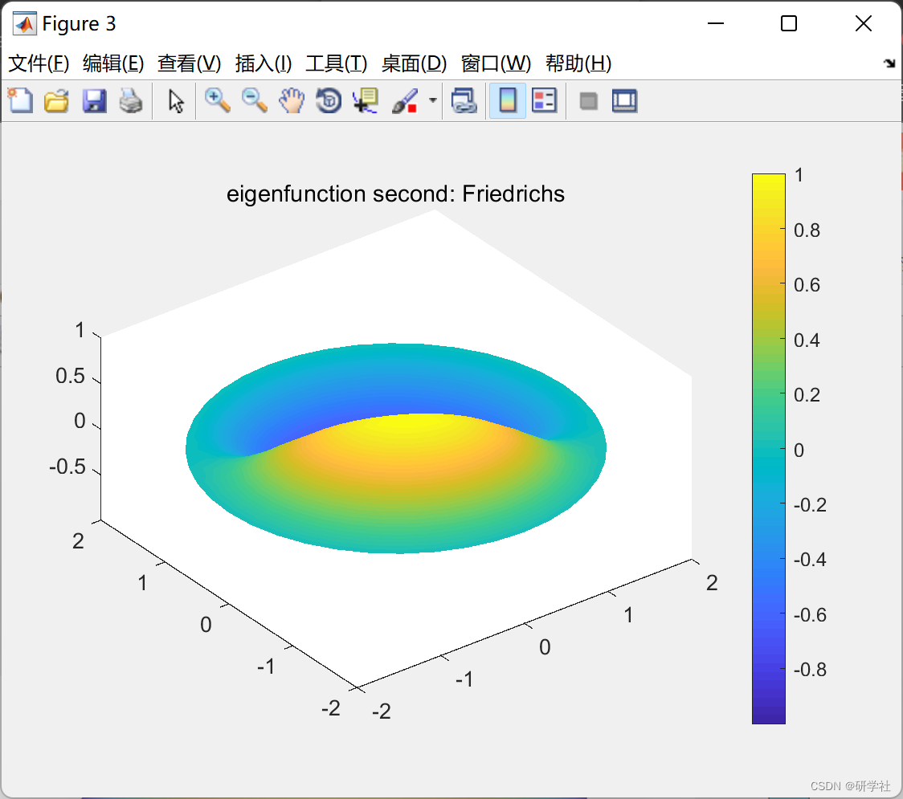
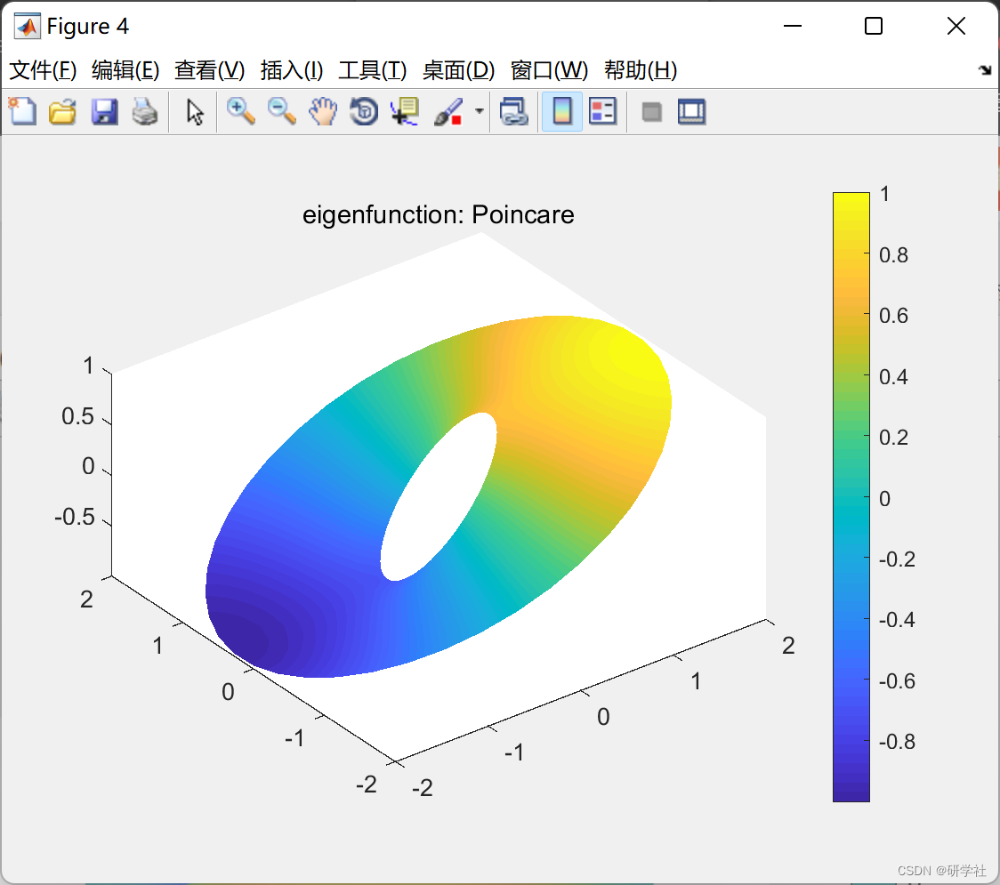
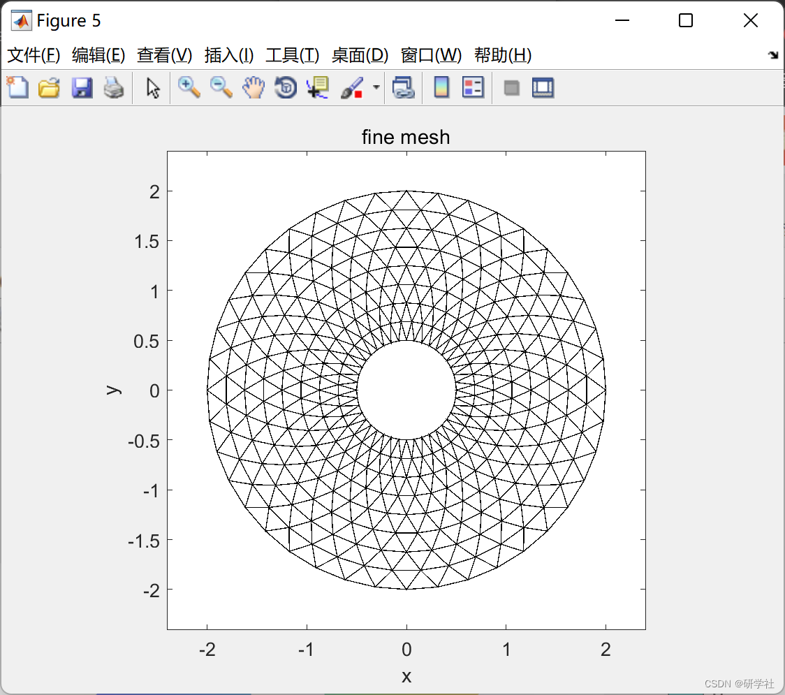
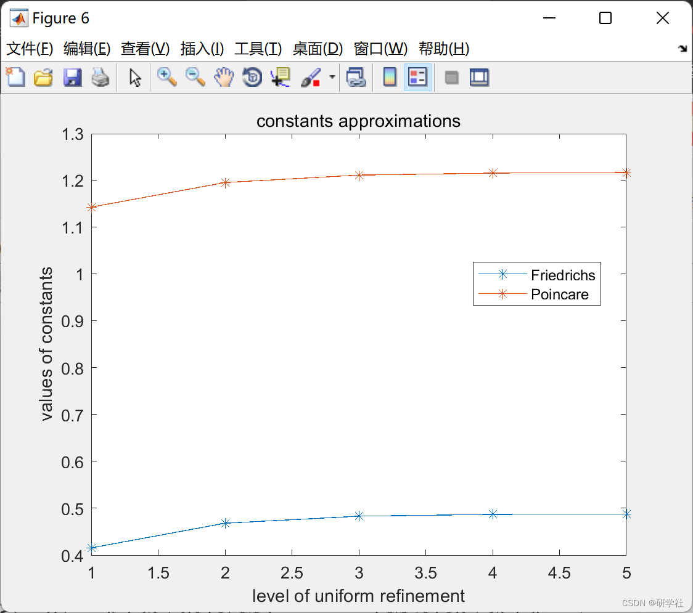
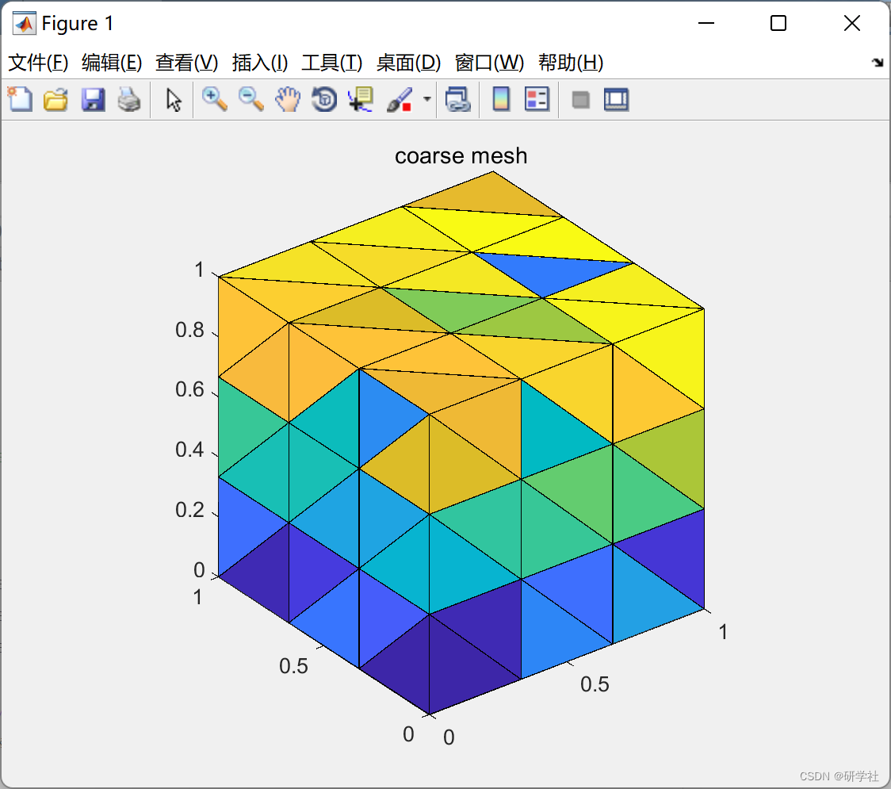
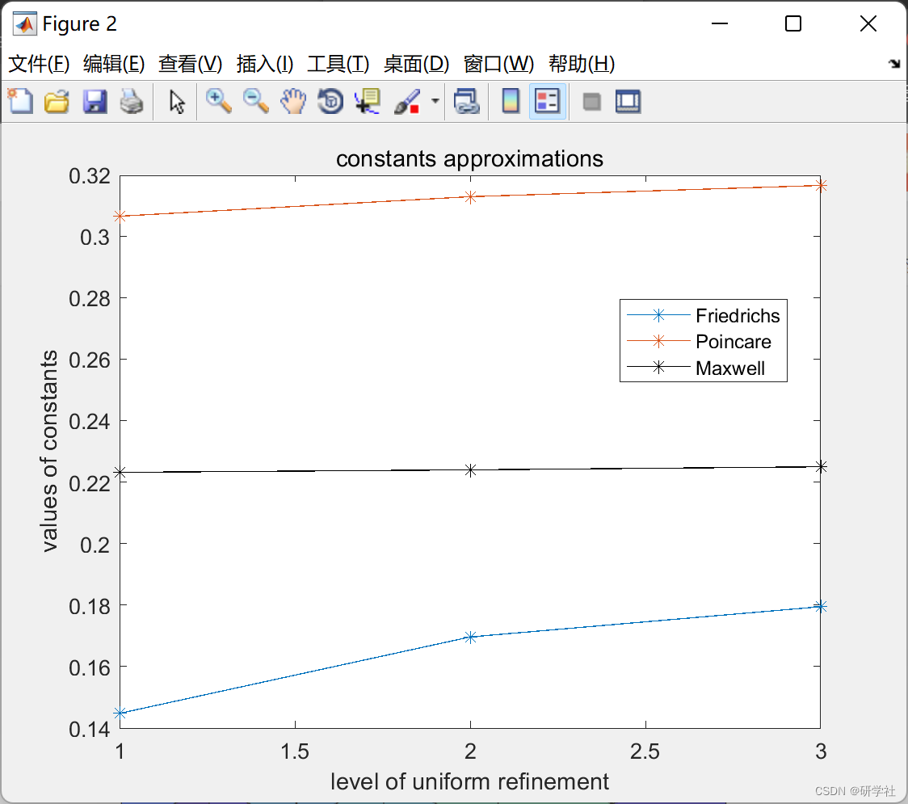
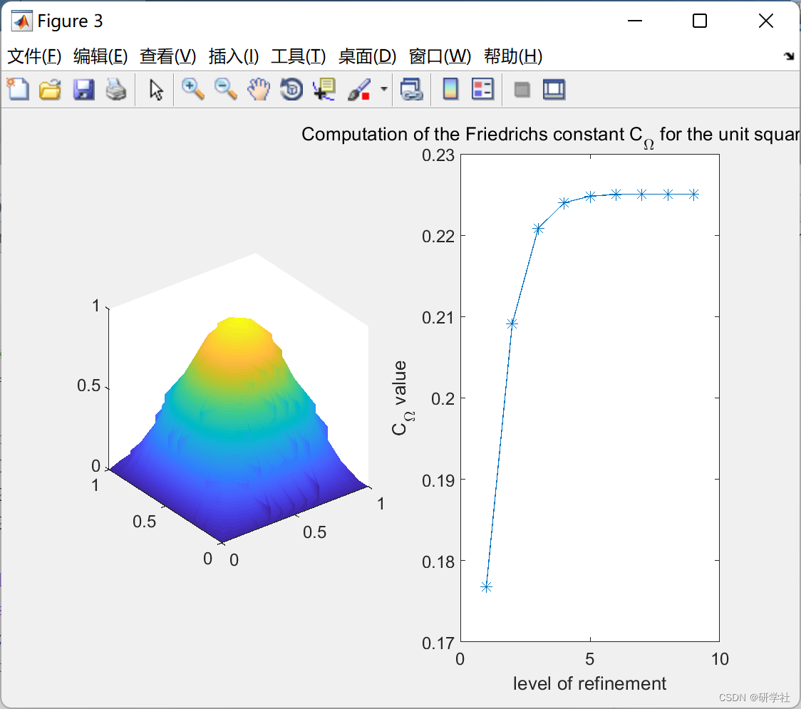

# Calculation of Friedrichs and Poincaré constants in 2D/3D (Matlab code implementation)

💥💥💞💞 Welcome to this blog❤️❤️💥💥
🏆 Bloggers' Advantages: 🌞🌞🌞 The content of the blog strives for rigorous thinking and clear logic to facilitate readers.
⛳️ Mantra: A journey of a thousand miles begins with a single step. Directory 💥1 Overview📚2 Run results 2D3D🎉3 References 🌈4 MATLAB code implementation
💥1 Overview The quality and stiffness matrix are assembled into nested uniform grids (triangles in 2D and tetrahedrons in 3D), starting from a coarse grid (level=1) with few elements, to the most refined grid (levels, where the level is predefined), depending on available memory.
Friedrichs and Gauss approximated the generalized eigenvalue problem. If known, the approximations are compared with the exact values (e.g., for rectangular domains in 2D and cuboidal domains in 3D), and the corresponding characteristic functions are visualized. The geometric domain can be easily changed by modifying the input matrix: node2coords, elems2nodes, dirichlet. There is also an experiment calculation of the Mach number. This article explains the original calculation of the Friedrich constant.
📚2 Run results 2D​Edit
​Edit
​Edit
​Edit
​Edit
​Edit
3D​Edit ​Edit
​Edit
Part of the code:
d=2; % Problem dimension
levels=5; % Level = 9 uniform refinement leading to elements=524288, edges=787456, nodes=263169 triagulation for the unit square problem
level_visualize=3;
levels_CF=levels; %level uniform refinement for the Friedrichs constant  
levels_CP=levels; %level uniform refinement for the Poincare constant  
levels_CM=0*levels; %level uniform refinement for the Maxwell constant, set zero to switch off this computation  
level_visualize_eigenfunctionF=min(levels_CF,level_visualize);  
level_visualize_eigenfunctionP=min(levels_CP,level_visualize);  
level_visualize_eigenfunctionM=min(levels_CM,level_visualize);  
if ~exist('levels')  
levels=max(max(levels_CF,levels_CP),levels_CM);  
end  
fprintf('The last level of uniform refinement is %d. ', levels);  
fprintf('Please wait for all levels. \n');  
fprintf('\n');  
switch model  
case 'rectangle'  
a=1; b=1;             %rectangle lengths  
%coarse mesh of the unit square  
nodes2coord = 0.5*[0 0; 1 0; 2 0; 2 1; 1 1; 0 1; 0 2; 1 2; 2 2];  
elems2nodes = [1 2 5; 5 6 1; 2 3 4; 2 4 5; 6 5 8; 6 8 7; 5 4 9; 5 9 8];  
dirichlet = [1 2; 2 3; 3 4; 4 9; 9 8; 8 7; 7 6; 6 1];  
nodes2coord(:,1)=nodes2coord(:,1)*a;  
nodes2coord(:,2)=nodes2coord(:,2)*b;  
[nodes2coord,elems2nodes,dirichlet] = refinement_uniform_2D(nodes2coord,elems2nodes,dirichlet);  
ab=[a,b];                      %max(max(nodes2coord,1))-min(min(nodes2coord,1));  
CF_exact=sum((pi./ab).^2)^(-1/2);          %exact value of the Fridrichs constant for rectangle a x b  
CP_exact=max(ab)/pi;                 %exact value of the Poincare constant  
CM_exact=CF_exact;                  %exact value of the Maxwell constant (with zero normal bc) if available  
case 'Lshape'  
%switching back to Lshape as in the first paper  
nodes2coord = 0.5*[0 0; 1 0; 2 0; 2 1; 1 1; 0 1; 0 2; 1 2];  
elems2nodes = [1 2 5; 5 6 1; 2 3 4; 2 4 5; 6 5 8; 6 8 7];  
dirichlet = [1 2; 2 3; 3 4; 4 5; 5 8; 8 7; 7 6; 6 1];  
[nodes2coord,elems2nodes,dirichlet] = refinement_uniform_2D(nodes2coord,elems2nodes,dirichlet);  
case 'annulus'  
a=0.5; b=2; L=2; N=10;  
[elems2nodes,nodes2coord,~,~,outer_boundary,inner_boundary]=get_ring_data(a,b,N,L);  
dirichlet=[outer_boundary; inner_boundary];  
end  
figure; show_mesh(elems2nodes,nodes2coord); xlabel('x'); ylabel('y'); axis image; enlarge_axis(0.1,0.1); title('coarse mesh');  
if printout  
prepare_to_print; print('-painters','-dpdf','mesh_coarse');  
end  
level_nodes = zeros(levels,1);  
level_edges = zeros(levels,1);  
level_CF=zeros(levels_CF,1);  
level_CP=zeros(levels_CP,1);  
level_CM=zeros(levels_CM,1);  
%level_CM_zeroEigenvalueMultiplicity=zeros(levels,1);  
for level=1:levels  
% uniform refinement  
if (level>1)  
if strcmp(model,'annulus')  
N=N*2; L=L*2;  
[elems2nodes,nodes2coord,~,~,outer_boundary,inner_boundary]=get_ring_data(a,b,N,L);  
dirichlet=[outer_boundary; inner_boundary];  
else  
[nodes2coord,elems2nodes,dirichlet] = refinement_uniform_2D(nodes2coord,elems2nodes,dirichlet);  
end  
end  
% affine transformations  
[B_K,~,B_K_det] = affine_transformations(nodes2coord,elems2nodes);  
% edgewise data for Nedelec0 and RT0 element  
elems2edges = get_edges(elems2nodes);  
signs = signs_edges(elems2nodes);  
assembly_all_matrices;  
dirichlet_nodes=unique(dirichlet);  
compute_constants;  
visualize_eigenfunctions;  
if level==level_visualize  
figure; show_mesh(elems2nodes,nodes2coord); xlabel('x'); ylabel('y'); axis image; enlarge_axis(0.1,0.1); title('fine mesh');  
if printout  
Prepare to print; print('-painters','-dpdf','mesh_fine');  
End  
End  
End  
Visualize constants;  
If strcmp(model,'rectangle')  
Test wave  
End  
🎉3 References  
[2] Talal Rahman, Jan Valdman, Fast MATLAB assembly of FEM matrices in 2D and 3D: nodal elements. Applied Mathematics and Computation 219, 7151–7158 (2013)  
[3] Immanuel Anjam, Jan Valdman, Fast MATLAB assembly of FEM matrices in 2D and 3D: Edge elements. Applied Mathematics and Computation 267, 252–263 (2015)  
🌈4 Matlab Code Implementation

## Images

<!-- PAYMENT_BLOCK -->

## Get this dataset

- Payment link (Stripe): [Buy now](https://buy.stripe.com/3cs8yP7sY87d0vu9AB)
- Payment QR code: 

<!-- /PAYMENT_BLOCK -->
